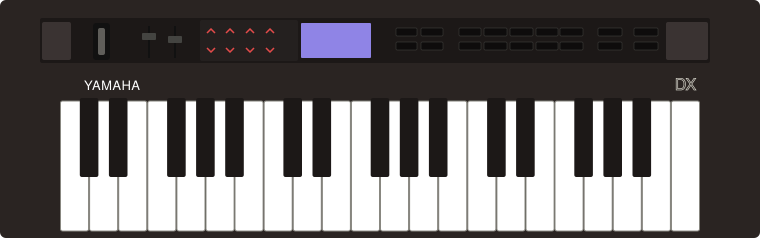

# MIDI clock switch firmware for the Yamaha reface DX

Unofficial firmware for the **Yamaha reface DX** that adds a switch to turn
off the MIDI clock it sends. Made from Yamaha's own firmware **v1.30**, the
last version Yamaha released.

This is independent work, not affiliated with or endorsed by Yamaha.
Yamaha's firmware is not included. You download its updater from Yamaha, and
the [patcher page](https://thade.github.io/reface-dx-firmware/) turns it into
the new firmware on your own computer and sends it to the DX. You can also
[build it yourself](#building-and-developing).

## What it adds

- **A CLOCK switch in the FUNCTION menu.** The DX normally sends MIDI clock
  all the time and Yamaha gives no way to stop it, which makes it hard to use
  as a keyboard alongside another clock source. This firmware adds a sixth
  FUNCTION page, **MIDI 2**, with one item, **CLOCK**. When CLOCK is off the
  DX sends no clock. The DX keeps the setting when it is switched off.
- **A version with the clock always off**, if you prefer no menu change.
  Four bytes differ from Yamaha's firmware.

Everything else is unchanged: sounds, the other FUNCTION pages, the Looper,
notes, Start and Stop, Active Sensing.

## Before you install

- **This replaces the main firmware of your DX.** The small built-in
  program that performs updates is never changed, so if anything goes wrong
  you can put Yamaha's firmware back the same way you installed this one.
  Yamaha's own updater has been run on a DX carrying this firmware, and a
  transfer that stopped partway was repeated from the start without harm.
  That is good evidence, not a guarantee.
- **Yamaha's licence does not allow altering or reverse-engineering its
  firmware without permission.** Installing this is your decision and your
  responsibility. This project's MIT licence covers its own code only and
  comes with no warranty.
- **Testing has been limited.** The firmware was installed and tested on
  one reface DX on 20 October 2026, over USB. Many things were checked in a
  software simulation of the DX rather than on the instrument (see
  [Known limitations](#known-limitations)).

## What you need

- A Yamaha **reface DX** with firmware v1.30 (every DX updated with Yamaha's
  updater has it). The reface CS shares the firmware file but has no
  display, so this project does not support it.
- Its AC adaptor, and a USB cable to a computer, with no hub in between.
- Chrome or Edge on a computer, so the patcher page can send the firmware to
  the DX. In another browser the page can still make the file, and you send
  it with a SysEx tool.
- Yamaha's reface CS/DX updater v1.30 download (the patcher page links to
  it).

## Install

1. **Make the file.** Open the
   [patcher page](https://thade.github.io/reface-dx-firmware/), download
   Yamaha's updater zip from the link there, and drop the zip on the page.
   It makes the firmware on your computer; nothing is uploaded.
2. **Put the DX into Update mode.** Power it from its AC adaptor and connect
   it by USB. Close any music software. Switch the DX off, hold the keys
   **F#3**, **A3** and **C#4** together, and switch it on. The display reads
   `reface DX Update`.
3. **Send the file.** On the page, press **Connect**, allow MIDI access when
   the browser asks, pick the reface port and press **Send**. The transfer
   takes about three minutes. Don't touch the DX or the cable until its
   display reads `Completed. 1.30 --> 1.30 Reboot.`
4. **Switch the DX off and on** with its Standby/On switch.

If the display stops at a percentage, switch the DX off, enter Update mode
again and send again. The same four steps with Yamaha's own updater put
Yamaha's firmware back.

## Using it

**The MIDI 2 page.** Press **FUNCTION** repeatedly. The pages are Voice,
Tuning, MIDI, System, Job, then **MIDI 2**, and the six dots in the title
bar show which one you are on.

**Switching the clock.** On MIDI 2, tap the leftmost **DATA ENTRY** switch,
the one that toggles AUTO P.OFF on the System page. CLOCK changes between
ON and off, and the clock stops or starts at once.

**Saving the setting.** The DX writes its settings to memory when you leave
the FUNCTION menu, by pressing any other button, the same as for every stock
setting. If you switch off while still on the FUNCTION pages, the change is
lost.

**External clock.** When the DX receives MIDI clock from another device it
follows that clock and sends none of its own, whatever CLOCK says. That is
how Yamaha made it. After three seconds without incoming clock it goes back
to its own.

**What still gets sent.** Active Sensing, notes, controllers, Start, Stop
and Continue from the Looper, and SysEx are not affected.

## Going back to Yamaha's firmware

Run Yamaha's own updater, following its guide: Update mode as in
[Install, step 2](#install), then start the updater. Your voices and
settings stay. The clock setting stays in memory too, and Yamaha's firmware
ignores it.

## If the DX won't start after an update

Update mode is entered with the three keys *before* the main firmware runs,
so a damaged main firmware can be replaced from Update mode. Switch the DX
off, hold **F#3**, **A3** and **C#4**, switch on, and run Yamaha's updater,
or this project's. This was exercised once when a transfer stopped at 98%
and was repeated.

## Known limitations

- Only USB MIDI has been checked on the instrument. The DIN MIDI OUT uses
  the same sending code and should behave the same, but this has not been
  measured.
- The CLOCK setting cannot be read or changed over SysEx. Yamaha's firmware
  only handles the documented system parameters that way, and this project
  did not extend it. The DX's own settings dump does include the byte.
- The reface CS has not been tested at all.
- Persistence, the page cycling and the key routing were each confirmed on
  the instrument once, on 20 October 2026; the rest of the behaviour rests
  on the software simulation described in
  [docs/menu-internals.md](docs/menu-internals.md).

## Building and developing

- **Build from source.** macOS and Python 3. Put Yamaha's updater zip,
  `reface_updater_CSDX_v130-3_mac.zip`, in `reface_csdx_fw/updater/` and run
  `reface_csdx_fw/tools/make_updaters.sh`. It extracts the stock image,
  builds the two patched payloads, runs every check, and makes re-signed
  copies of Yamaha's updater app with each payload. Rosetta is needed on
  Apple Silicon because the app is Intel-only.
- **Checks.** `tools/selftest.py` pins the SHA-256 of all three payloads
  (standard library only). With `unicorn` and `capstone` installed in
  `reface_csdx_fw/venv`, `tools/verify_menu.py`, `tools/verify_ui.py` and
  `tools/verify_paths.py` run the patched firmware in an emulator: the real
  parameter engine, the real key dispatcher from the FUNCTION button to the
  settings save, the screen renderer, the boot-time settings load and the
  SysEx paths.
- **The browser patcher** lives in [patcher/](patcher/README.md);
  `tools/export_recipe.py` writes its recipes from the stock file.
- [Firmware notes](docs/firmware-notes.md): the updater format, the CPU,
  the clock sender and the patches.
- [Menu internals](docs/menu-internals.md): the FUNCTION menu, parameter
  system, LCD and settings persistence.
- [Hardware tests](docs/hardware-tests.md) and the
  [write-up](docs/writeup.md).

## Licence and credits

MIT licence for this repository's code and documentation: see
[LICENSE](LICENSE). Yamaha and reface are trademarks of Yamaha Corporation.
The board details quoted in the notes come from
[sandsoftwaresound.net](http://sandsoftwaresound.net/inside-reface-dx-and-cs/).
